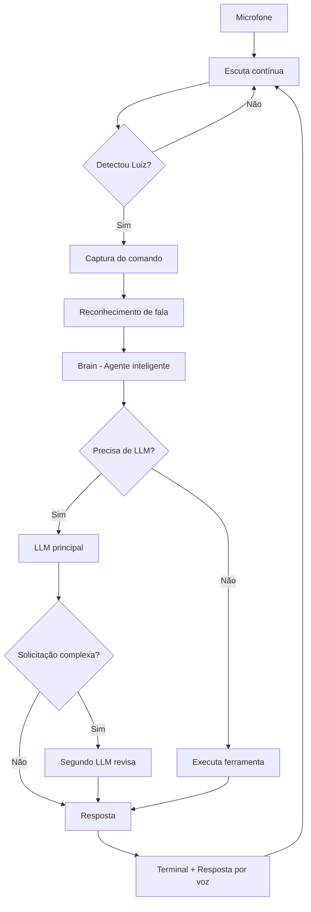

# Luiz — Assistente Pessoal por Voz com Inteligência Artificial

Um assistente pessoal inteligente desenvolvido em Python, capaz de ouvir continuamente, reconhecer uma palavra de ativação (*wake word*), interpretar comandos de voz, executar tarefas automatizadas e responder utilizando modelos de Inteligência Artificial.

O **Luiz** combina automação local com inteligência artificial, integrando GPT e Gemini em uma arquitetura de respostas em ensemble, com foco em eficiência, economia de tokens e controle de consumo.

## ✨ Funcionalidades

### 🎙️ Assistente por voz
- Escuta contínua pelo microfone.
- Ativação exclusiva por palavra-chave: **"Luiz"**.
- Captura e interpretação de comandos de voz.
- Conversão de texto em fala (TTS).
- Reconhecimento de fala (STT).
- Respostas exibidas no terminal e reproduzidas por voz.

### 🧠 Inteligência Artificial em Ensemble

Integração com OpenAI GPT e Google Gemini para melhorar a qualidade das respostas sem aumentar desnecessariamente o consumo de tokens.

- **Política Adaptive (padrão):** utiliza um único LLM na maioria das interações e aciona o segundo apenas em solicitações mais complexas.
- **Revisão inteligente:** o segundo modelo atua como revisor da resposta inicial, sem necessidade de uma terceira chamada para síntese.
- **Política Single:** utiliza exclusivamente o modelo principal.
- **Política Always:** utiliza os dois modelos em todas as interações.
- **Cache em memória:** evita chamadas repetidas para solicitações já processadas durante a execução.

### ⚡ Gerenciamento de Energia e Tokens

O Luiz possui um sistema de controle de consumo diário de tokens, chamado de *Energia*.

| Consumo diário | Comportamento |
|---|---|
| Até 69% | Funcionamento normal |
| 70% | Aviso de energia baixa |
| 95% | Entra automaticamente em modo sono |
| Novo dia | Reset automático da cota |

O consumo considera os tokens utilizados pelos modelos GPT e Gemini.

Durante o modo sono, o assistente interrompe o processamento de novos comandos até a renovação da cota diária.

### 🛠️ Automação de tarefas

O Luiz consegue executar ações diretamente no ambiente local:

- Abrir sites no navegador.
- Executar scripts Python autorizados.
- Realizar chamadas HTTP para APIs.
- Criar arquivos com conteúdo definido por voz.
- Interpretar solicitações e selecionar ferramentas disponíveis.

## 🏗️ Arquitetura do Projeto

O projeto foi organizado em módulos para separar captura de áudio, processamento inteligente, execução de ferramentas e gerenciamento da aplicação.

```text
LUiz/
│
├── run.py
│
├── src/
│   └── luiz/
│       ├── app.py
│       │
│       ├── audio/
│       │   ├── captura de áudio
│       │   ├── reconhecimento de fala (STT)
│       │   └── síntese de voz (TTS)
│       │
│       └── agent/
│           ├── brain.py
│           └── tools.py
│
├── scripts/
│   └── scripts locais permitidos
│
├── .env.example
├── requirements.txt
└── README.md
```

**Responsabilidades dos principais módulos:**

| Arquivo | Responsabilidade |
|---|---|
| `run.py` | Inicialização da aplicação |
| `app.py` | Loop principal de áudio e orquestração |
| `audio/` | Captura, reconhecimento e reprodução de voz |
| `brain.py` | Inteligência do agente e integração com LLMs |
| `tools.py` | Catálogo e execução das ferramentas |
| `scripts/` | Scripts locais autorizados |

## 🔄 Fluxo de Funcionamento



## 🚀 Tecnologias Utilizadas

- **Python 3.11+** — linguagem principal.
- **OpenAI GPT** — processamento inteligente de linguagem natural.
- **Google Gemini** — modelo complementar para revisão e análise.
- **Speech-to-Text (STT)** — reconhecimento de comandos de voz.
- **Text-to-Speech (TTS)** — reprodução das respostas.
- **APIs HTTP** — integração com serviços externos.
- **Python-dotenv** — gerenciamento de variáveis de ambiente.

## 📋 Requisitos

- Windows 10 ou Windows 11.
- Python 3.11 ou superior (recomendado 3.12).
- Microfone configurado e funcionando.
- Conexão com a internet para utilização dos modelos de IA.
- Chave de API da OpenAI e/ou Google Gemini.

## ⚙️ Instalação

**1. Clone o repositório**

```bash
git clone URL_DO_REPOSITORIO
cd Luiz
```

**2. Crie o ambiente virtual**

```powershell
python -m venv .venv
```

**3. Ative o ambiente virtual**

```powershell
.\.venv\Scripts\Activate.ps1
```

**4. Instale as dependências**

```bash
pip install -r requirements.txt
```

**5. Configure as variáveis de ambiente**

```powershell
Copy-Item .env.example .env
```

Abra o arquivo `.env` e configure suas chaves de API.

```env
OPENAI_API_KEY=sua_chave_openai
GEMINI_API_KEY=sua_chave_gemini
```

É necessário configurar pelo menos uma chave para utilizar respostas abertas com IA.

Para habilitar o modo combinado, configure as duas.

**6. Execute o assistente**

```bash
python run.py
```

Após a inicialização, o Luiz permanecerá em escuta contínua, aguardando a palavra de ativação.

## 🎤 Comandos de Voz

Para executar os comandos, primeiro diga **"Luiz"** e depois a solicitação desejada.

| Comando | Ação |
|---|---|
| `abra site github.com` | Abre o GitHub no navegador |
| `rode script exemplo.py` | Executa um script autorizado |
| `chamar api https://api.github.com` | Realiza uma chamada para uma API |
| `criar arquivo notas.txt conteudo: revisar projeto` | Cria um arquivo com o conteúdo informado |
| `encerrar` | Finaliza o assistente |

## 🔧 Configurações

O comportamento do Luiz pode ser personalizado pelo arquivo `.env`.

| Variável | Descrição |
|---|---|
| `LUIZ_WAKE_WORDS` | Variações aceitas para a palavra de ativação |
| `LUIZ_OPENAI_MODEL` | Modelo GPT utilizado |
| `LUIZ_GEMINI_MODEL` | Modelo Gemini utilizado |
| `LUIZ_PRIMARY_LLM` | Define o modelo principal (`openai` ou `gemini`) |
| `LUIZ_DUAL_POLICY` | Política de utilização dos modelos |
| `LUIZ_DAILY_TOKEN_BUDGET` | Limite diário de tokens |
| `LUIZ_QUOTA_WARNING_RATIO` | Percentual para aviso de consumo (padrão: `0.70`) |
| `LUIZ_QUOTA_SLEEP_RATIO` | Percentual para ativar o modo sono (padrão: `0.95`) |
| `LUIZ_QUOTA_STATE_FILE` | Arquivo de persistência do consumo diário |
| `LUIZ_STT_MODEL` | Modelo de reconhecimento (`tiny`, `base` ou `small`) |
| `LUIZ_INPUT_SECONDS` | Duração da janela de escuta da wake word |
| `LUIZ_COMMAND_SECONDS` | Duração da captura do comando |
| `LUIZ_ENERGY_THRESHOLD` | Sensibilidade de captação do áudio |

### Políticas de IA

| Política | Funcionamento | Consumo |
|---|---|---|
| `adaptive` | Segundo modelo somente em solicitações complexas | Equilibrado |
| `single` | Apenas o modelo principal | Menor |
| `always` | Dois modelos em todas as interações | Maior |

A política `adaptive` é a configuração recomendada para equilibrar qualidade das respostas e custo operacional.

## 🔐 Segurança e Observações

- A execução de scripts é restrita à pasta `scripts`.
- As chaves de API devem permanecer no arquivo `.env`.
- Não compartilhe suas credenciais ou publique o arquivo `.env`.
- Sem as duas chaves configuradas, o assistente continua podendo executar as ferramentas locais, mas as respostas abertas ficam limitadas ao modelo disponível.
- O funcionamento das ferramentas locais não depende necessariamente de uma chamada aos modelos de IA.
- O modo sono bloqueia novas solicitações até a renovação diária da cota.

## 📊 Estado do Projeto

<details>
<summary><strong>V1 — Funcional</strong></summary>

- [x] Escuta contínua pelo microfone.
- [x] Detecção da palavra de ativação.
- [x] Captura de comandos por voz.
- [x] Integração com ferramentas locais.
- [x] Abertura de sites.
- [x] Execução de scripts autorizados.
- [x] Integração com APIs externas.
- [x] Criação de arquivos por comando de voz.
- [x] Respostas por texto e voz.
- [x] Integração com OpenAI e Gemini.
- [x] Sistema de respostas em ensemble.
- [x] Política adaptativa de utilização dos LLMs.
- [x] Cache em memória.
- [x] Controle de consumo diário de tokens.
- [x] Sistema de aviso de energia e modo sono.

</details>

---

**Luiz** é um projeto de assistente pessoal que busca aproximar a inteligência artificial da rotina do usuário, permitindo interações naturais por voz e execução de tarefas diretamente no computador.

*Desenvolvido em Python com integração a modelos de Inteligência Artificial.*
